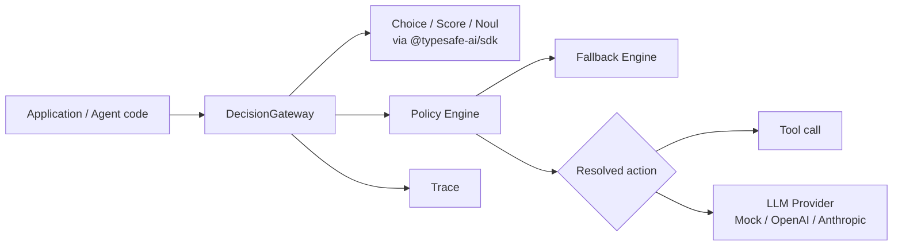

# jev-decision-gateway

A decision gateway that sits in front of expensive generative LLMs: application and agent code asks
[Jev](https://typesafe.ai) ("System One") the small, bounded, structured questions it's actually
good at, a deterministic policy layer turns Jev's typed, confidence-scored answers into an
execution plan, and a real generative LLM is invoked only when the policy says generation is
actually needed.

## The problem

Modern AI applications and agents make a huge number of small, frequent, _structured_ decisions
that don't require text generation at all: "should the agent keep going?", "which tool next?", "is
this document relevant?", "does this output pass verification?", "should we escalate?". Routing
every one of these through an expensive generative LLM means paying generation-level latency and
cost for what's really a bounded classification or a boolean gate — and then defensively parsing
whatever text comes back into a usable enum anyway.

## Before / after

**Before** — every control decision is its own generative LLM call:

```
agent loop, each iteration:
  LLM call: "which tool next?"        (parse free text -> tool name)
  LLM call: "should I keep going?"    (parse free text -> yes/no)
  LLM call: "does this pass?"         (parse free text -> yes/no)
  LLM call: generate the final answer
```

Four LLM calls per iteration, three of which never needed generation — they needed a typed,
bounded answer.

**After** — bounded decisions are batched through Jev in one call; the LLM is invoked only for the
one step that actually needs it:

```
agent loop, each iteration:
  ONE gateway.evaluate() call -> { nextTool, shouldContinue, verifyOutput, modelTier }
  IF finished: ONE LLM call to generate the final answer, at the tier Jev picked
```

This project's flagship example (`examples/agent-runtime-optimizer`) and benchmark
(`benchmark/ai-agent-scenario`) implement exactly this shape — see "Run the flagship example and
benchmark" below.

## What Jev actually is — and isn't

Jev is a real, hosted model (`@typesafe-ai/sdk`) purpose-built for bounded, enumerable-outcome
decisions — `Choice` (pick from named options), `Score` (position on an ordered scale), and `Noul`
(probability a statement is true) — returning typed, calibrated answers instead of generated text
to parse. It is genuinely useful for the class of decision described above.

It is **not** a replacement for a generative LLM, and this project does not claim it is. Jev cannot
write a paragraph, synthesize a summary, produce code, or carry out open-ended, multi-step
reasoning — there's no enumerable `criteria` for "write a helpful response to this ticket." Every
example and benchmark here still calls a real `LLMProvider` (`packages/providers`) for the
generation half of the work; Jev only ever gates _when_ and _how_ that generation happens.

See **[`docs/jev-understanding.md`](docs/jev-understanding.md)** for the full picture: confirmed
SDK shapes, confidence semantics (including Noul's derived-confidence convention), auth/transport/
error handling, and an honest "when Jev is and isn't the right tool" section.

## Quickstart

```sh
npm install
npm run build
cp .env.example .env
# then fill in .env — see below
```

`npm run build` (a workspace-wide `tsc -b`) is not optional here: every package's `package.json`
points its `main`/`types` fields at `./dist`, not `./src`, and there is no dev-mode source alias —
without a build, nothing importable from another workspace package (which is most of this repo)
actually resolves yet. Run it once after `npm install` on a fresh clone, and again after pulling
changes to any `packages/*`/`examples/*`/`benchmark/*` source file you didn't build yourself. (The
CLI's `npx jev-gateway` command below also only works from inside a clone of this workspace — it is
a `"private": true`, unpublished package, not something installable via `npx` from the npm
registry.)

`.env.example` (verbatim):

```
# API key for TypeSafe API
TYPESAFE_API_KEY=

# API key for OpenAI
OPENAI_API_KEY=

# API key for Anthropic
ANTHROPIC_API_KEY=
```

Only `TYPESAFE_API_KEY` is required for `DecisionGateway` itself. `OPENAI_API_KEY`/
`ANTHROPIC_API_KEY` are only needed if you construct an `OpenAIProvider`/`AnthropicProvider` from
`packages/providers` directly — the flagship example and benchmark use a deterministic
`MockProvider` and need neither.

A minimal, real `gateway.evaluate()` call — everything below the import line is byte-identical to
the project's own live integration test (`packages/core/test/live/jev.live.test.ts`, which really
runs against the live Jev API whenever `TYPESAFE_API_KEY` is set), demonstrating all three question
types answered in a single batched call:

```ts
import { DecisionGateway } from "@jev-decision-gateway/core";
import type {
  ChoiceDecisionDef,
  NoulDecisionDef,
  ScoreDecisionDef,
} from "@jev-decision-gateway/core";

const gateway = new DecisionGateway();

const sentiment: ChoiceDecisionDef = {
  kind: "choice",
  id: "sentiment",
  instructions: "Classify the sentiment of the text.",
  options: {
    positive: "the text expresses a positive sentiment",
    negative: "the text expresses a negative sentiment",
    neutral: "the text is neutral in tone",
  },
  policy: { minConfidence: 0, fallbackAction: "neutral" },
};

const quality: ScoreDecisionDef = {
  kind: "score",
  id: "quality",
  instructions: "Rate how clearly the text is written, from 0 (very unclear) to 1 (very clear).",
  levels: ["unclear", "somewhat clear", "clear", "very clear"],
  policy: {
    minConfidence: 0,
    thresholds: [
      { atOrAbove: 0.75, action: "very clear" },
      { atOrAbove: 0.5, action: "clear" },
      { atOrAbove: 0.25, action: "somewhat clear" },
    ],
    fallbackAction: "unclear",
  },
};

const isQuestion: NoulDecisionDef = {
  kind: "noul",
  id: "isQuestion",
  instructions: "Is the text phrased as a question?",
  trueDescription: "the text is a question",
  falseDescription: "the text is not a question",
  policy: {
    minConfidence: 0,
    trueAction: "question",
    falseAction: "statement",
    fallbackAction: "statement",
  },
};

const result = await gateway.evaluate({
  state: { text: "I absolutely love how simple this API is to use!" },
  decisions: { sentiment, quality, isQuestion },
});

// result.decisions.sentiment.action     -> "positive" | "negative" | "neutral"
// result.decisions.quality.action       -> "unclear" | "somewhat clear" | "clear" | "very clear"
// result.decisions.isQuestion.action    -> "question" | "statement"
// every outcome's .confidence is a number in [0, 1], or null if it fell back
// (usedFallback: true) -- e.g. with no TYPESAFE_API_KEY set at all.
```

`DecisionGateway` picks up `TYPESAFE_API_KEY` from the environment automatically
(`new DecisionGateway()` with no config); with no key at all, `evaluate()` still resolves normally
— every decision comes back as a `MISSING_KEY` fallback outcome instead of throwing (see "What this
is / isn't" below).

The full public API surface exported from `packages/core/src/index.ts` is `DecisionGateway` plus
these types: `ChoiceDecisionDef`, `DecisionDef`, `DecisionOutcome`, `DecisionSet`, `DecisionState`,
`DecisionTrace`, `EvaluationResult`, `FallbackReason`, `GatewayConfig`, `NoulDecisionDef`,
`ScoreDecisionDef`. Nothing from `packages/core/src/jev/` (the internal `@typesafe-ai/sdk` adapter
boundary) is exported publicly.

## Architecture



`DecisionGateway.evaluate()` batches any number of independent decisions into exactly **one** Jev
call. `DecisionGateway.chain()` handles the dependent/sequential case — no native SDK primitive
exists for "answer this, then use the answer to shape the next question," so `chain()` is this
project's own orchestration layer over repeated `evaluate()` steps. See
**[`docs/architecture.md`](docs/architecture.md)** for the full module-boundary explanation, both
methods' concrete signatures, and the trace-flow (`DecisionTrace`, `onTrace`, `TraceCollector`).

## Run the flagship example and the benchmark

The flagship example (`examples/agent-runtime-optimizer`) is an agent control loop — tool routing,
continue/stop, model-tier selection, and a speculative output-verification pre-check (`verifyOutput`
is asked before generation runs each iteration, so it's only actually informed by real draft content
on a verify-retry — see `docs/jev-understanding.md` section 6) — gated by `DecisionGateway` instead
of ad-hoc LLM calls, including a `gateway.chain()` pre-flight step that classifies the task and picks
a tool subset before the main loop starts. The benchmark (`benchmark/ai-agent-scenario`) runs 12
synthetic tasks through both a naive baseline (one LLM call per control decision) and the
JEV-gated version, and reports the difference.

Via the CLI (`packages/cli`, binary name `jev-gateway`):

```sh
npx jev-gateway run --example agent-runtime-optimizer
npx jev-gateway benchmark --tasks 12 --out benchmark/ai-agent-scenario/results/example-run.json
```

Or directly, without the CLI:

```sh
npx tsx examples/agent-runtime-optimizer/src/run.ts --task "Inspect recent logs for an error, and report a one-line summary of what you found."
npx tsx benchmark/ai-agent-scenario/src/run.ts --tasks 12 --out benchmark/ai-agent-scenario/results/example-run.json
```

Both run fully without any API key at all — with no `TYPESAFE_API_KEY`, every Jev decision
resolves via its documented fallback action instead of crashing, and the transcript/report clearly
mark every such decision `[FALLBACK: MISSING_KEY]`. With a real `TYPESAFE_API_KEY` set, the same
commands make real, live Jev calls. Neither ever needs `OPENAI_API_KEY`/`ANTHROPIC_API_KEY` — both
use the deterministic, zero-network `MockProvider` for the generation half, with every simulated
cost/latency number explicitly labeled as simulated in the output.

## Benchmark Results

A real, live-key run of `benchmark/ai-agent-scenario` across all 12 synthetic tasks (2026-09-19 UTC,
`@typesafe-ai/sdk@0.6.0`) — full write-up, methodology, and honest limitations discussion in
**[`benchmark/ai-agent-scenario/REPORT.md`](benchmark/ai-agent-scenario/REPORT.md)**; raw JSON in
[`benchmark/ai-agent-scenario/results/example-run.json`](benchmark/ai-agent-scenario/results/example-run.json).
(A Task 11 code review found and fixed a per-task "LLM calls avoided" reconciliation bug — see
`REPORT.md`'s "Fixed" section — so these are the corrected, re-run numbers.)

| Metric                 | `baseline` (all simulated) | `jevGated` (real Jev + simulated generation)                                |
| ---------------------- | -------------------------- | --------------------------------------------------------------------------- |
| LLM calls              | 132                        | 36                                                                          |
| Simulated LLM latency  | 184,800.0 ms               | 23,800.0 ms                                                                 |
| Simulated LLM cost     | $0.060285                  | $0.010292                                                                   |
| Real Jev calls         | — (0)                      | 75 (228 decisions, 32,232.9 ms total, avg confidence 0.81)                  |
| Real Jev fallback rate | —                          | 30.7% (70/228 decisions, all `LOW_CONFIDENCE` — 0 `ERROR`, 0 `MISSING_KEY`) |

**Savings (simulated)**: 96 LLM calls avoided, $0.049993 saved, 161,000.0 ms saved — and the
per-task "LLM calls avoided" column in `REPORT.md` now genuinely sums to this same 96, task by
task. Jev's own billing cost: `n/a — no public pricing found as of 2026-09`.

One real, verbatim transcript excerpt (from `examples/agent-runtime-optimizer`, real key, task
"Inspect recent logs for an error, and report a one-line summary of what you found."):

```
[Pre-flight chain: 2 dependent Jev calls, category="lookup", toolSubset="searchOnly", 2750.2ms real]

--- Iteration 1/6 ---
[Jev fan-out: 1 systemOne call, 4 questions, 411.8ms real, tokens in=740 out=121]
  modelTier        -> mock-fast    (confidence 0.70)
  nextTool         -> search       (confidence 0.86)
  shouldContinue   -> continue     (confidence 0.78)
  verifyOutput     -> fail         (confidence 0.88)
> tool:search("Inspect recent logs for an error, and report a one-line summary of what you found.") -> "[search] No canned result for "Inspect recent logs for an error, and report a one-line summary of what you found." (generic demo fallback -- the real tool would look this up live)."

=== Summary ===
Iterations used: 4/6 | Verify retries: 2/2
Real Jev calls: 6 (4272.2ms total measured, avg confidence 0.77)
Simulated LLM calls: 3 (1350.0ms simulated, $0.000112 simulated)
Fallbacks triggered: 8
```

See `REPORT.md` for the full per-task breakdown, real latency distribution, confidence-distribution
discussion, acceptance-criteria verification (test/typecheck/lint/security), and limitations.

## What this is / isn't

**This is**: a decision gateway for the bounded, enumerable-outcome control decisions that
otherwise get routed through a generative LLM unnecessarily — tool routing, continuation gates,
verification gates, model-tier selection, coarse classification. It fails open by design: any Jev
outage, timeout, missing key, or malformed response resolves to a documented, per-decision fallback
action instead of throwing.

**This isn't**: a replacement for generative LLMs, a guarantee that Jev is always cheaper or faster
than the alternative for your workload, or a system that should decide _everything_. It doesn't do
open-ended generation, long-form synthesis, or complex multi-step reasoning — those still belong to
`OpenAIProvider`/`AnthropicProvider` (or any `LLMProvider`), invoked only when the policy layer
decides generation is actually warranted. The hard iteration/retry caps in the flagship example are
deliberately enforced in plain code, never by a Jev answer, precisely because Jev is a decision
input, not a substitute for your own safety bounds.

## Roadmap

See **[`ROADMAP.md`](ROADMAP.md)** for what's explicitly deferred beyond this MVP pass — more
examples, more benchmark scenarios, more CLI commands, additional provider adapters, npm
publishing, and more — and why.

## License

[MIT](LICENSE) — Copyright (c) 2026 jev-decision-gateway contributors.
