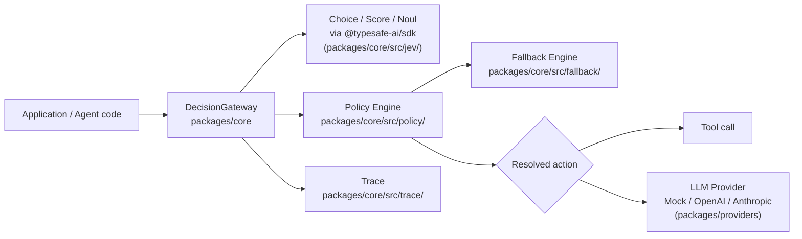

# Architecture

This is a short supplement to the README's narrative — module boundaries, the `evaluate()` vs.
`chain()` distinction, and the trace flow. See `docs/jev-understanding.md` for what Jev itself is
and returns.

## Module boundary



`packages/core/src/jev/` is the only place `@typesafe-ai/sdk` is ever imported (enforced by
convention, not tooling — see Global Constraint 1 in the project's build plan). It exposes one pure
boundary function, `askJev()`, which returns a typed answer or `null` and never applies any
decision logic itself. `policy/engine.ts#applyPolicy()` turns a raw answer (or `null`) into a
`DecisionOutcome`: it applies each decision's own `minConfidence` threshold, resolves the
Choice/Score/Noul-specific action-resolution rule, and delegates every fallback case (low
confidence, missing key, transport error, malformed response) to
`fallback/engine.ts#fallbackOutcome()` — the single place a fallback `DecisionOutcome` is ever
constructed. `trace/trace.ts#createTrace()` builds a `DecisionTrace` from a `DecisionDef` +
`DecisionOutcome` pair. None of `policy/`, `fallback/`, or `trace/` import anything from `jev/`
beyond its exported types (`FallbackReason`, `RawJevAnswer`) — they never talk to the SDK directly.

`packages/providers` (Mock/OpenAI/Anthropic `LLMProvider` implementations) is a separate,
independent package with no dependency on `packages/core` at all — it only shares the
`LLMProvider`/`LLMRequest`/`LLMResponse` interface across its own three implementations. Whether or
not to call an `LLMProvider` at all, and which tier/model to use, is decided by application code
reading a `DecisionOutcome` (see `examples/agent-runtime-optimizer/src/loop.ts`), not by
`packages/core` itself — `DecisionGateway` has no knowledge of `LLMProvider` and never calls one.

## `evaluate()` vs. `chain()`

Both are methods on `DecisionGateway` (`packages/core/src/gateway.ts`). They answer two different
shapes of question: independent, parallel decisions in one round trip, vs. a decision whose inputs
depend on an earlier decision's resolved output.

```ts
class DecisionGateway {
  async evaluate<TSet extends DecisionSet>(args: {
    state: DecisionState;
    decisions: TSet;
    signal?: AbortSignal;
  }): Promise<EvaluationResult<TSet>>;

  async chain<T>(
    initialState: DecisionState,
    callback: (ctx: {
      evaluate: <TSet extends DecisionSet>(args: {
        state?: DecisionState;
        decisions: TSet;
        signal?: AbortSignal;
      }) => Promise<EvaluationResult<TSet>>;
    }) => Promise<T>
  ): Promise<{
    value: T;
    steps: EvaluationResult<DecisionSet>[];
    trace: DecisionTrace[];
    totalLatencyMs: number;
  }>;
}
```

**`evaluate()`** — batched, parallel fan-out. Every entry in the `decisions` map (a `DecisionSet`,
i.e. `{ [id: string]: DecisionDef }`) is sent, and answered, in exactly **one**
`askJev()`/`systemOne()` call, no matter how many decisions it contains. This is the default and
the common case: any set of decisions that don't depend on each other's answers belongs in one
`evaluate()` call. If Jev is unavailable (no key, transport error, timeout), every decision in the
set resolves to its own fallback outcome — the batch never partially throws.

**`chain()`** — dependent, sequential decisions. There is no native SDK primitive for "answer this,
then use the answer to shape the next question" (see `docs/jev-understanding.md` section 7), so
`chain()` is this project's own orchestration: it runs a callback that receives an `evaluate`
closure, and each call to that closure shallow-merges its own `state` argument over the chain's
`initialState` (per-call state wins on key conflicts) before internally calling
`this.evaluate(...)`. Every step's full `EvaluationResult` is recorded into `steps`, and every
step's trace entries are concatenated into the returned `trace`. The flagship example's pre-flight
pair (classify a task's category, then pick a tool subset whose options depend on that category) is
the concrete instance of this pattern — see `docs/jev-understanding.md` section 7 for the actual
code.

## Trace flow

Every decision produced by either `evaluate()` or `chain()` gets one `DecisionTrace`
(`packages/core/src/trace/trace.ts`):

```ts
interface DecisionTrace {
  traceId: string;
  decisionId: string;
  kind: "choice" | "score" | "noul";
  timestamp: string;
  question: { instructions?: string; criteriaSummary: string };
  rawAnswer: unknown | null;
  confidence: number | null;
  policyApplied: { minConfidence: number; matchedRule?: string };
  action: string;
  usedFallback: boolean;
  fallbackReason?: FallbackReason;
  latencyMs: number;
}
```

`createTrace(def, outcome)` builds this from a `DecisionDef` and the `DecisionOutcome` produced for
it — `criteriaSummary` is a short human-readable string (e.g. `"choice: search|calculator|finish"`
or `"score: 4 levels"`), deliberately never the full option/level/description text or any
surrounding `state`. `DecisionGateway` creates one `TraceCollector`
(`packages/core/src/trace/collector.ts`) per `evaluate()`/`chain()` call, appends every decision's
trace to it, and also invokes `GatewayConfig.onTrace?.(trace)` once per decision if a hook was
configured — so a caller can stream traces (e.g. to logging/observability) in addition to reading
the batch's own `EvaluationResult.trace` array afterward. Nothing in this path ever imports
`@typesafe-ai/sdk`; `rawAnswer`/`confidence`/`action` all come from the already-mapped
`DecisionOutcome`, not from a raw SDK response.
